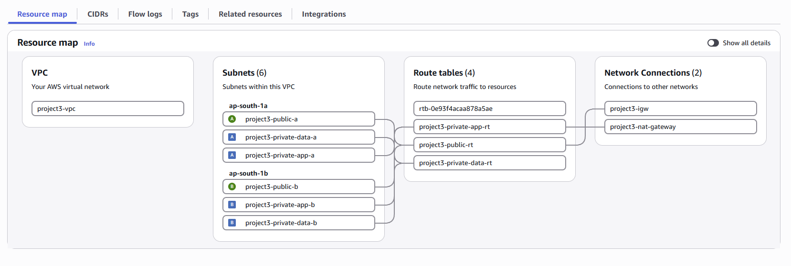
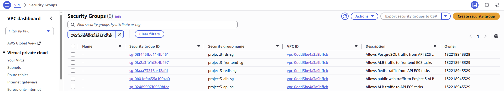
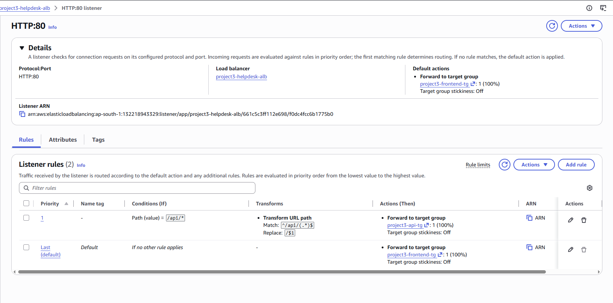
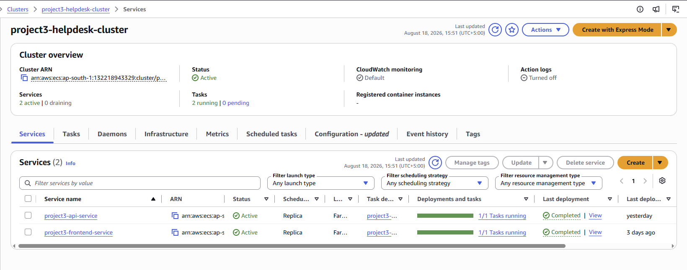
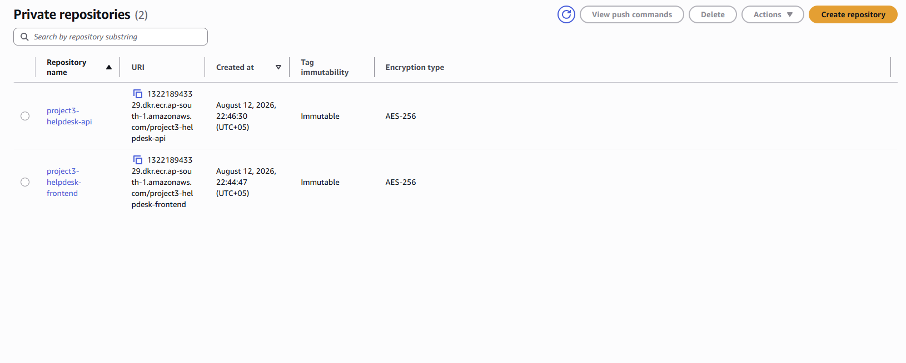
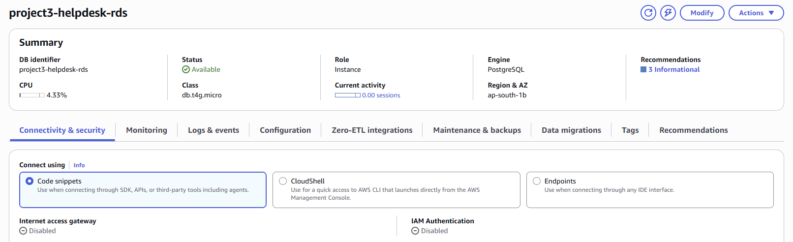
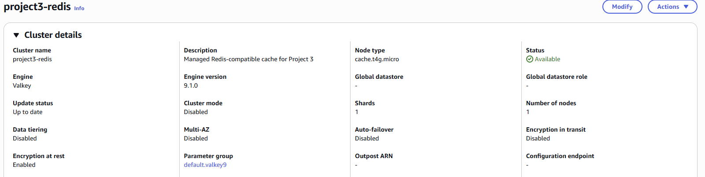
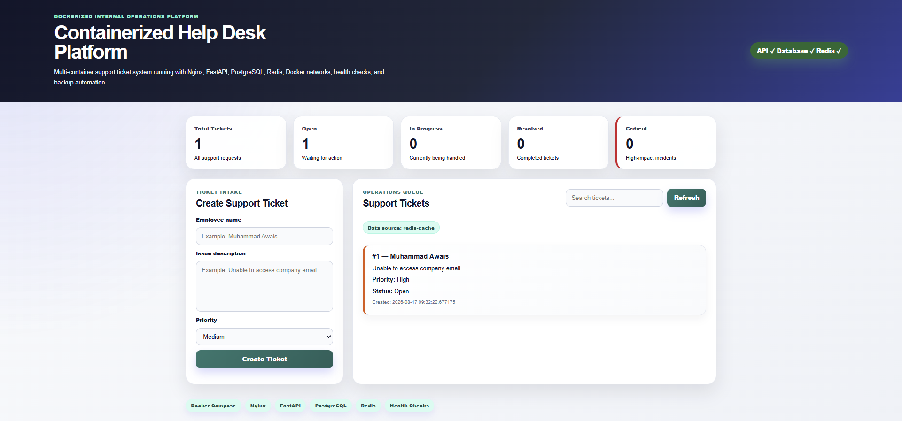
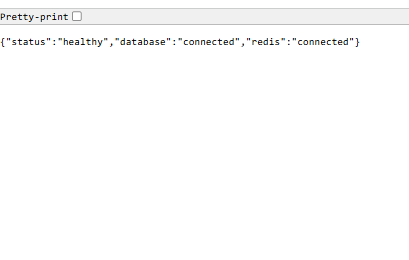

# Production-Oriented AWS Cloud Deployment

## Evidence Qualification

See [historical evidence scope](docs/evidence-scope.md) and [production-control status](docs/production-controls.md). Security-group tables record documented intent; the saved group-list screenshot does not establish exact rules or denied-path enforcement. Historical results are not current live checks.

> **Deployment status:** This portfolio deployment has been decommissioned. Screenshots and validation results document the original implementation. Reference configurations are provided for review; the environment is not currently hosted.

> Designed, deployed and validated a containerized application on AWS using private networking, ECS Fargate, ALB, RDS, ElastiCache and CloudWatch.

## Overview

This project demonstrates the migration and deployment of a previously containerized multi-service Help Desk platform onto AWS using a production-style cloud architecture.

The application acts as the workload while the engineering focus is on cloud infrastructure, container orchestration, networking, security, load balancing, managed data services, observability, troubleshooting, and operational validation.

The workload originates from **Project 2 — Containerized Help Desk Platform**:

https://github.com/awais-clouddev/containerized-help-desk-platform

---

## Architecture


> **Architecture note:** Amazon ECR is shown within the VPC boundary for visual simplicity. ECR is actually an AWS regional managed service outside the VPC. ECS/Fargate tasks pull container images from ECR.

The platform is deployed in the AWS **Asia Pacific (Mumbai) — `ap-south-1`** Region using a custom VPC with public, private application, and private data subnets across multiple Availability Zones.

User traffic enters through an internet-facing Application Load Balancer. The ALB routes frontend traffic to the Nginx ECS/Fargate service and `/api/*` traffic to the FastAPI/Uvicorn ECS/Fargate service. The API communicates privately with Amazon RDS PostgreSQL and Amazon ElastiCache for Valkey.

---

## AWS Services & Technology Stack

| Layer | Technology | Role |
|---|---|---|
| Networking | Amazon VPC | Isolated cloud network for the deployment |
| Edge | Application Load Balancer | Single internet-facing entry point and path-based routing |
| Compute | Amazon ECS + AWS Fargate | Runs the frontend and API containers without managing EC2 hosts |
| Registry | Amazon ECR | Stores private frontend and API container images |
| Frontend | Nginx + HTML/CSS/JavaScript | Serves the Help Desk web interface |
| API | Python + FastAPI + Uvicorn | Handles application API requests |
| Database | Amazon RDS PostgreSQL | Persistent ticket data |
| Cache | Amazon ElastiCache for Valkey | Redis-compatible caching layer |
| Observability | Amazon CloudWatch | Centralized logs, metrics, and CPU alarm |
| Access Control | AWS IAM | Controls access to AWS resources |

### Core AWS Resources

- ECS cluster: `project3-helpdesk-cluster`
- Frontend service: `project3-frontend-service`
- API service: `project3-api-service`
- Application Load Balancer: `project3-helpdesk-alb`
- Frontend target group: `project3-frontend-tg`
- API target group: `project3-api-tg`
- PostgreSQL database: `project3-helpdesk-rds`
- Valkey cache: `project3-redis`

---

## Network & Security Architecture

The environment uses a custom VPC with separate network tiers so that only the load balancer is directly exposed to the internet.

### Network Layers

- **Public subnets** — host the internet-facing Application Load Balancer.
- **Private application subnets** — host the frontend and API ECS/Fargate tasks with public IP assignment disabled.
- **Private data subnets** — isolate PostgreSQL and the Valkey cache from direct internet access.



### Security Group Flow

Traffic is restricted by service-specific security groups:

| Security Group | Allowed Inbound Traffic | Source |
|---|---|---|
| `project3-alb-sg` | HTTP `80` | Internet |
| `project3-frontend-sg` | TCP `80` | ALB security group only |
| `project3-api-sg` | TCP `8000` | ALB security group only |
| `project3-rds-sg` | PostgreSQL `5432` | API security group only |
| `project3-redis-sg` | Valkey/Redis-compatible `6379` | API security group only |



This design prevents direct internet access to the ECS workloads, database, and cache while allowing only the communication paths required by the application.

---

## Load Balancing & ECS/Fargate

The Application Load Balancer provides the single public entry point for the platform and performs path-based routing to separate frontend and API target groups.

### Routing Rules

- `/` → `project3-frontend-tg` → `project3-frontend-service`
- `/api/*` → URL rewrite → `project3-api-tg` → `project3-api-service`

The API listener rule rewrites incoming API requests using:

`^/api/(.*)$` → `/$1`



### ECS Services

The application runs as two independent services in the ECS cluster `project3-helpdesk-cluster` using AWS Fargate:

- `project3-frontend-service` — Nginx frontend container on port `80`
- `project3-api-service` — FastAPI/Uvicorn API container on port `8000`

Both services were deployed successfully and reached a stable state with `1/1 Tasks running`.



Both target groups were also validated as healthy:

- Frontend target group → `HTTP:80` → Healthy
- API target group → `HTTP:8000` → Healthy

---

## Container Registry & Managed Data Layer

### Amazon ECR

Frontend and API container images are stored in private Amazon ECR repositories:

- `project3-helpdesk-frontend`
- `project3-helpdesk-api`

The repositories were configured with immutable image tags and AES-256 encryption.



### Amazon RDS PostgreSQL

Persistent application data is stored in the managed PostgreSQL database `project3-helpdesk-rds`.

The database is deployed in the private data layer with direct public internet access disabled. PostgreSQL traffic on port `5432` is permitted only from the API security group.



### Amazon ElastiCache for Valkey

The application caching layer uses the managed cache `project3-redis` running Valkey `9.1.0`, a Redis-compatible engine.

The cache listens on port `6379` and is restricted to the API security group. Encryption at rest is enabled.



---

## Monitoring & Observability

Amazon CloudWatch provides centralized visibility into the running API workload through logs, metrics, and alarms.

### Application Logs

The API writes runtime logs to:

`/ecs/project3-helpdesk-api`

CloudWatch log events confirmed successful health-check requests with HTTP `200 OK` responses.


### CPU Monitoring

The CloudWatch alarm `project3-api-high-cpu-alarm` monitors ECS API service CPU utilization.

- Metric: `CPUUtilization`
- Service: `project3-api-service`
- Cluster: `project3-helpdesk-cluster`
- Statistic: `Average`
- Period: `5 minutes`
- Threshold: greater than `80%`
- Datapoints to alarm: `1 of 1`


The CPU alarm was monitoring-only; no SNS notification or automated action was attached.

---

## End-to-End Validation

The complete deployment was validated through the public Application Load Balancer after all infrastructure components reached a healthy state.

Validation confirmed:

- Frontend successfully served through the ALB
- `/api/*` requests successfully routed to the FastAPI service
- Frontend target group healthy
- API target group healthy
- PostgreSQL database connectivity successful
- Valkey cache connectivity successful
- Ticket creation and persistence successful
- Dashboard endpoint successfully returned application statistics
- Cached ticket retrieval verified through the Redis-compatible cache interface
- CloudWatch application logging verified

### Application Validation



> **Application UI note:** The frontend was reused from Project 2 and retains Docker Compose/Redis terminology. In this AWS deployment, ECS/Fargate ran the containers, and Amazon ElastiCache for Valkey provided Redis-compatible caching.

The running application confirmed successful connectivity across the application, database, and caching layers and returned cached ticket data using `redis-cache` as the data source.

### API Health Validation

The API health endpoint returned:

```json
{
  "status": "healthy",
  "database": "connected",
  "redis": "connected"
}
```



---

## Engineering Troubleshooting

This deployment included several real infrastructure and application failures that were diagnosed and resolved during implementation.

| Incident | Root Cause | Resolution |
|---|---|---|
| ECS frontend service creation failed | Security group already existed and CloudFormation attempted to create it again | Deleted the failed stack and recreated the service using the existing `project3-frontend-sg` |
| Incorrect ECS subnet selected | A private data subnet was selected during service configuration | Corrected the service networking to use the private application subnets |
| ECS API service creation failed | Existing `project3-api-sg` conflicted with automatic security-group creation | Deleted the failed stack and reused the existing API security group |
| API target remained unhealthy | Target group health check was configured for `/` | Changed the API health-check path to `/health` |
| `/api/tickets` returned HTTP 500 | PostgreSQL `tickets` table did not exist | Connected to private RDS through AWS CloudShell and initialized the required table |
| Application could not be considered fully validated | Individual components worked but end-to-end connectivity still needed verification | Tested ALB routing, API health, PostgreSQL persistence, Valkey caching, dashboard responses, and CloudWatch logs |

These troubleshooting incidents demonstrate operational diagnosis across ECS, CloudFormation, networking, load balancing, application health checks, and managed database services.

Detailed troubleshooting documentation: [docs/troubleshooting.md](docs/troubleshooting.md)

---

> **Availability limitation:** Although the VPC spans two Availability Zones, each ECS service was validated with only one running task. The deployment therefore does not demonstrate automatic application failover or full high availability.

## Production Hardening & Operational Considerations

This project implements a production-oriented AWS architecture while remaining a temporary portfolio deployment. The repository therefore distinguishes between controls that were implemented and improvements that would be required for a long-lived production environment.

### Implemented

- Custom VPC with public, private application, and private data tiers
- ECS/Fargate tasks with public IP assignment disabled
- Service-specific security groups and restricted east-west traffic
- Internet-facing ALB as the only public application entry point
- Private PostgreSQL database access
- Private Valkey cache access
- ECR image tag immutability and AES-256 encryption
- Valkey encryption at rest
- CloudWatch centralized API logs
- CloudWatch CPU utilization alarm
- Target-group health checks and end-to-end validation

### Recommended for Long-Lived Production

- HTTPS `443` using AWS Certificate Manager and a custom domain
- HTTP-to-HTTPS redirection
- Multi-AZ database deployment where availability requirements justify it
- Cache replication/failover where required
- Encryption in transit for the Valkey cache layer
- Centralized secrets management
- Automated infrastructure provisioning with Infrastructure as Code
- CI/CD-based application deployment
- Expanded CloudWatch alarms and notification channels
- Automated backup, recovery, and disaster-recovery procedures

> The repository intentionally does not claim production controls that were not actually implemented.

---

## Documentation

| Document | Purpose |
|---|---|
| [Architecture](docs/architecture.md) | AWS architecture and service relationships |
| [Networking](docs/networking.md) | VPC, subnet, routing, and network-tier design |
| [Security](docs/security.md) | Security groups and traffic boundaries |
| [Deployment](docs/deployment.md) | AWS deployment workflow |
| [Observability](docs/observability.md) | CloudWatch logs, metrics, and alarms |
| [Troubleshooting](docs/troubleshooting.md) | Real deployment failures and resolutions |
| [Validation](docs/validation.md) | Infrastructure and application verification |
| [Cost Management](docs/cost-management.md) | Cost controls and cleanup strategy |

---

## Repository Structure

```text
production-ready-aws-cloud-deployment/
├── README.md
├── LICENSE
├── .gitignore
├── architecture/
│   └── aws-deployment-architecture.png
├── docs/
│   ├── architecture.md
│   ├── networking.md
│   ├── security.md
│   ├── deployment.md
│   ├── observability.md
│   ├── troubleshooting.md
│   ├── validation.md
│   ├── cost-management.md
└── screenshots/
    └── AWS deployment and validation evidence
```

---

## Project Progression

This project builds on the containerized Help Desk platform from Project 2 and moves the workload into AWS using production-oriented cloud infrastructure and managed services.

**Project 2:** Docker and Docker Compose platform engineering.

**Project 3:** AWS networking, ECS/Fargate, load balancing, private data services, security, observability, validation, and operations.

---

## Author

**Muhammad Awais**

Cloud & DevOps Engineering Portfolio

## Application Version and Schema Reference

See [application provenance and schema](docs/application-provenance.md). The historical deployed image/source versions are unknown. The pinned current Docker reference must not be presented as a newly verified AWS deployment.

## Historical Availability Boundary

The ECS screenshot shows one running task per service. Two-AZ networking
does not establish redundant application instances or tested failover.

The Valkey screenshot shows one node, Multi-AZ disabled and automatic
failover disabled. Database failover was not demonstrated by the retained
evidence. No current runtime availability is asserted.

## Offline Maintenance and Reference Material

- [Application provenance and schema](docs/application-provenance.md)
- [Historical evidence scope](docs/evidence-scope.md)
- [Production-control status](docs/production-controls.md)
- [Reference configuration](reference/README.md)
- [Proposed recovery runbook](docs/recovery-runbook.md)

Run local checks from the repository root:

    python3 scripts/validate_offline.py

These checks inspect JSON, selected configuration relationships, provenance,
local links and preservation of historical images. They do not contact AWS,
validate service API acceptance, deploy infrastructure or establish live
networking, IAM enforcement, TLS, notification delivery, recovery or failover.

The reference files are newly authored examples, not complete IaC or exports
of deleted resources. Unknown historical values remain explicitly unknown.
