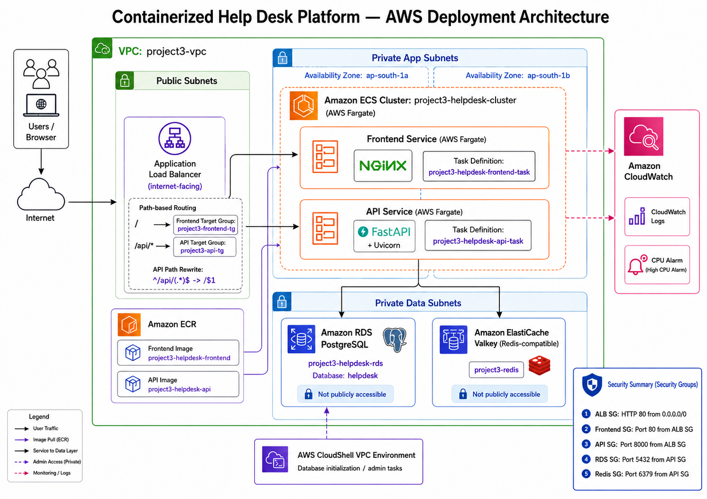

# Architecture & AWS Service Design

> **Deployment status:** Historical portfolio deployment, subsequently decommissioned. The author reports that paid AWS services were deleted. Screenshots and successful runtime results describe the earlier deployment, not a currently running environment. Current account inventory and billing have not been independently verified. This maintenance work is offline and does not recreate AWS resources.

## Purpose

This document describes the AWS architecture used to deploy the containerized Help Desk platform and explains how the major AWS services interact.

The deployment uses a layered architecture that separates public ingress, application workloads, and managed data services inside a custom Amazon VPC.



---

## Architecture Overview

The application is deployed in the AWS Asia Pacific (Mumbai) Region (`ap-south-1`) using Amazon ECS on AWS Fargate.

The architecture consists of three primary tiers:

1. **Public ingress layer** — Application Load Balancer
2. **Private application layer** — frontend and API ECS/Fargate services
3. **Private data layer** — Amazon RDS PostgreSQL and Amazon ElastiCache for Valkey

Supporting AWS services include Amazon ECR for container images, Amazon CloudWatch for observability, and AWS IAM for access control.

---

## Request Flow

```text
User
  |
  v
Internet
  |
  v
Application Load Balancer
  |
  +-- / --------------------> Frontend Target Group
  |                              |
  |                              v
  |                       Frontend ECS Service
  |                          AWS Fargate
  |                             Nginx
  |
  +-- /api/* -------------> API Target Group
                                 |
                                 v
                           API ECS Service
                            AWS Fargate
                        FastAPI + Uvicorn
                                 |
                         +-------+-------+
                         |               |
                         v               v
                  RDS PostgreSQL   ElastiCache Valkey
```

---

## Amazon VPC

A dedicated VPC named `project3-vpc` provides network isolation for the deployment.

The VPC is divided into:

- Public subnets for internet-facing infrastructure
- Private application subnets for ECS/Fargate workloads
- Private data subnets for database and cache resources

The architecture spans multiple Availability Zones to distribute infrastructure across separate failure domains.

ECS tasks run with public IP assignment disabled.

---

## Application Load Balancer

The internet-facing Application Load Balancer `project3-helpdesk-alb` acts as the single public entry point.

Listener configuration:

- Protocol: HTTP
- Port: `80`
- Default traffic → `project3-frontend-tg`
- `/api/*` traffic → `project3-api-tg`

The API listener rule performs the URL transformation:

```text
^/api/(.*)$  ->  /$1
```

This allows public API requests such as `/api/health` to reach the FastAPI application internally as `/health`.

---

## Amazon ECS & AWS Fargate

The workload runs in the ECS cluster:

`project3-helpdesk-cluster`

Two independent ECS services were created:

### Frontend Service

- Service: `project3-frontend-service`
- Task definition: `project3-helpdesk-frontend-task:1`
- Container port: `80`
- Runtime: AWS Fargate
- Application server: Nginx

### API Service

- Service: `project3-api-service`
- Task definition: `project3-helpdesk-api-task:1`
- Container port: `8000`
- Runtime: AWS Fargate
- Application runtime: Python, FastAPI, and Uvicorn

Both services were validated with `1/1 Tasks running` and healthy Application Load Balancer targets.

---

## Amazon ECR

Private Amazon ECR repositories store the application container images:

- `project3-helpdesk-frontend`
- `project3-helpdesk-api`

Repository controls verified during deployment include:

- Immutable image tags
- AES-256 encryption

ECS task definitions reference these ECR images when launching Fargate tasks.

---

## Amazon RDS PostgreSQL

The persistent data layer uses Amazon RDS PostgreSQL.

- Database identifier: `project3-helpdesk-rds`
- Engine: PostgreSQL
- Database name: `helpdesk`
- Public internet access: disabled
- Application port: `5432`

The database is reachable only from the API security group.

The Help Desk `tickets` table stores persistent ticket records created through the application.

---

## Amazon ElastiCache for Valkey

The caching layer uses Amazon ElastiCache with the Valkey Redis-compatible engine.

- Cache name: `project3-redis`
- Engine: Valkey
- Engine version: `9.1.0`
- Node type: `cache.t4g.micro`
- Port: `6379`
- Encryption at rest: enabled

The cache is accessible only from the API security group.

The application continues to use the Redis-compatible protocol, which is why application responses may identify the cache source as `redis-cache`.

---

## Amazon CloudWatch

Amazon CloudWatch provides centralized operational visibility.

Implemented monitoring includes:

- API application log group: `/ecs/project3-helpdesk-api`
- ECS CPU utilization monitoring
- Alarm: `project3-api-high-cpu-alarm`
- CPU threshold: greater than `80%`
- Evaluation period: `5 minutes`
- Datapoints to alarm: `1 of 1`

CloudWatch logs were also used during troubleshooting to identify the missing PostgreSQL `tickets` table.

---

## AWS IAM

AWS Identity and Access Management controls administrative access to AWS resources used by the project.

IAM is treated as a supporting control-plane service rather than part of the application request path.

---

## Architecture Characteristics

The deployed design demonstrates:

- Network segmentation
- Private application workloads
- Private managed data services
- Service-specific security boundaries
- Path-based application routing
- Serverless container compute
- Managed relational storage
- Managed Redis-compatible caching
- Centralized logging and monitoring
- Health-based load balancing
- End-to-end operational validation

---

## Related Documentation

- [Networking](networking.md)
- [Security](security.md)
- [Deployment](deployment.md)
- [Observability](observability.md)
- [Troubleshooting](troubleshooting.md)
- [Validation](validation.md)

## Historical Availability Boundary

The ECS screenshot shows one running task per service. Two-AZ networking
does not establish redundant application instances or tested failover.

The Valkey screenshot shows one node, Multi-AZ disabled and automatic
failover disabled. Database failover was not demonstrated by the retained
evidence. No current runtime availability is asserted.
