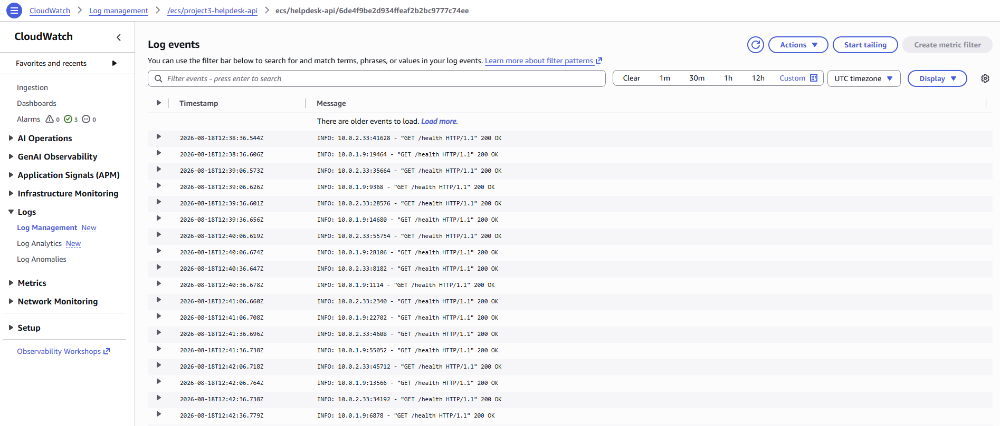
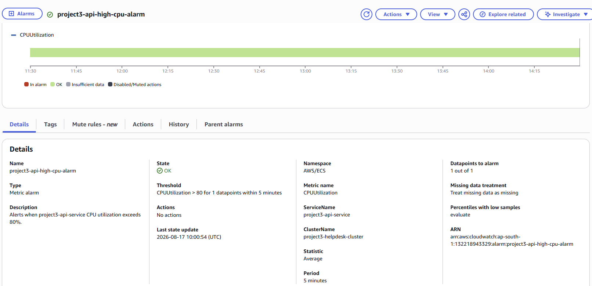

# Monitoring & Observability

> **Deployment status:** This portfolio deployment has been decommissioned. Screenshots and validation results document the original implementation. Reference configurations are provided for review; the environment is not currently hosted.

## Purpose

This document describes the monitoring and observability controls implemented for the AWS deployment using Amazon CloudWatch.

The monitoring design provides visibility into API runtime behavior, ECS service health, application logs, and CPU utilization.

---

## CloudWatch Log Group

The API workload sends application logs to the CloudWatch log group:

`/ecs/project3-helpdesk-api`

The log group was configured with a retention period of one week.

CloudWatch logs captured FastAPI/Uvicorn runtime activity, load-balancer health checks, application requests, and application errors.



---

## Health-Check Visibility

CloudWatch log events confirmed successful API health-check requests such as:

```text
GET /health HTTP/1.1 200 OK
```

These requests originate from the Application Load Balancer health-check process and provide evidence that the API task is responding successfully.

---

## Troubleshooting Through Logs

CloudWatch was used during a real application failure when `/api/tickets` returned HTTP `500`.

The API logs exposed the PostgreSQL error:

```text
relation "tickets" does not exist
```

This identified the root cause as a missing database table rather than a networking, load-balancer, or ECS connectivity problem.

After the PostgreSQL schema was initialized, the application endpoint returned successfully.

---

## ECS CPU Monitoring

Amazon CloudWatch monitors ECS service CPU utilization using the `AWS/ECS` namespace.

The monitored workload is:

- Cluster: `project3-helpdesk-cluster`
- Service: `project3-api-service`
- Metric: `CPUUtilization`
- Statistic: `Average`
- Period: `5 minutes`

---

## CPU Alarm

The following CloudWatch alarm was created:

`project3-api-high-cpu-alarm`

Alarm configuration:

- Metric: `CPUUtilization`
- Threshold: greater than `80%`
- Evaluation period: `5 minutes`
- Datapoints to alarm: `1 of 1`
- Missing data: treated as missing

The alarm was monitoring-only, with no SNS notification or automated action attached. It provides an operational signal when average API service CPU utilization exceeds 80% during a five-minute evaluation period.



---

## Observability Coverage

The implemented monitoring provides visibility into:

- API runtime logs
- HTTP request activity
- ALB health-check responses
- Application exceptions
- PostgreSQL application errors
- ECS CPU utilization
- CloudWatch alarm state
- Application health validation

---

## Current Limitations

This temporary portfolio deployment intentionally uses a limited monitoring scope.

For a long-lived production environment, observability could be expanded with:

- Additional ECS CPU and memory alarms
- ALB HTTP `4xx` and `5xx` monitoring
- Target response-time monitoring
- RDS CPU, connection, storage, and latency alarms
- Valkey memory and cache-performance monitoring
- SNS or other notification channels
- Centralized dashboards
- Application performance monitoring
- Distributed tracing where required

> These items are production recommendations and were not implemented as part of the current deployment.

---

## Evidence

- [CloudWatch API Logs](../screenshots/11-cloudwatch-api-logs.png)
- [CloudWatch CPU Alarm](../screenshots/12-cloudwatch-api-cpu-alarm.png)
- [API Health Validation](../screenshots/14-api-health-connectivity.png)

---

## Related Documentation

- [Architecture](architecture.md)
- [Deployment](deployment.md)
- [Troubleshooting](troubleshooting.md)
- [Validation](validation.md)
