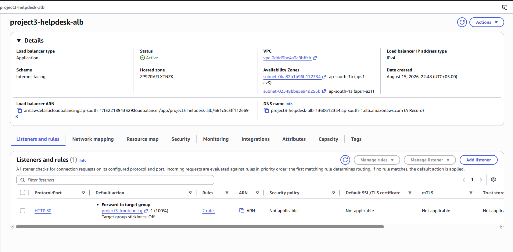
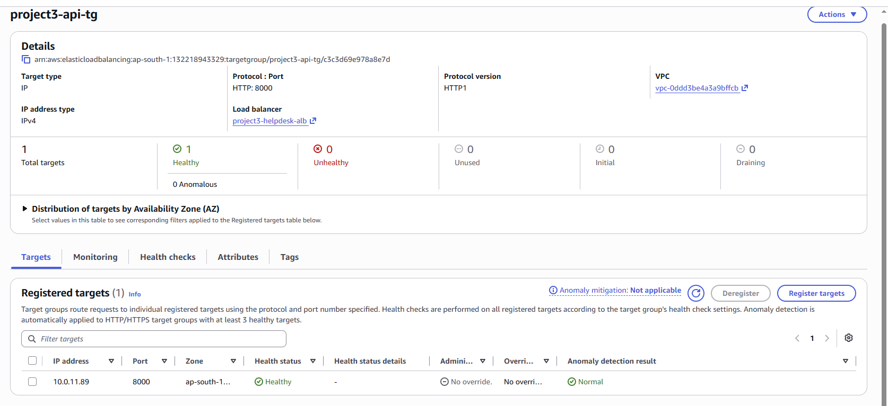
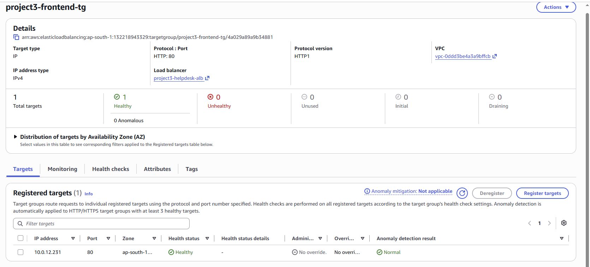

# Testing & Validation Evidence

## Purpose

This document records the infrastructure and application validation performed after deployment to confirm that the AWS environment was working end to end.

Validation was performed across networking, load balancing, ECS/Fargate, PostgreSQL, Valkey, application functionality, and CloudWatch observability.

---

## Validation Summary

| Validation Area | Result |
|---|---|
| VPC and subnet architecture | Passed |
| Security-group boundaries | Passed |
| Application Load Balancer | Passed |
| ALB path-based routing | Passed |
| Frontend ECS/Fargate service | Passed |
| API ECS/Fargate service | Passed |
| Frontend target health | Healthy |
| API target health | Healthy |
| ECR repositories | Verified |
| RDS PostgreSQL availability | Available |
| PostgreSQL connectivity | Connected |
| Valkey cache availability | Available |
| Valkey connectivity | Connected |
| Ticket creation | Passed |
| Ticket persistence | Passed |
| Ticket retrieval | Passed |
| Dashboard endpoint | Passed |
| Cached ticket retrieval | Passed |
| CloudWatch application logs | Verified |
| CloudWatch CPU alarm | Configured |

---

## 1. VPC Validation

The VPC resource map was reviewed to confirm the intended three-tier network structure:

- Public subnets
- Private application subnets
- Private data subnets

The VPC also showed the Internet Gateway, NAT Gateway, and associated route-table relationships.


---

## 2. Security Group Validation

Security groups were reviewed to confirm the intended service-to-service trust boundaries.

Validated traffic paths:

- Internet -> ALB on port `80`
- ALB -> frontend on port `80`
- ALB -> API on port `8000`
- API -> PostgreSQL on port `5432`
- API -> Valkey on port `6379`


---

## 3. Application Load Balancer Validation

The Application Load Balancer `project3-helpdesk-alb` was confirmed as Active and internet-facing.

Listener routing was validated as:

- Default traffic -> `project3-frontend-tg`
- `/api/*` -> `project3-api-tg`

The API URL rewrite rule was also verified.




---

## 4. Target Health Validation

Both Application Load Balancer target groups were validated as healthy.

### API Target

- Port: `8000`
- Health status: Healthy
- Anomaly detection: Normal



### Frontend Target

- Port: `80`
- Health status: Healthy
- Anomaly detection: Normal



---

## 5. ECS/Fargate Validation

The ECS cluster `project3-helpdesk-cluster` was confirmed as Active.

Validated service state:

- Services: `2 active`
- Tasks: `2 running`
- `project3-api-service` -> `1/1 Tasks running`
- `project3-frontend-service` -> `1/1 Tasks running`


---

## 6. ECR Validation

Both application container repositories were verified in Amazon ECR:

- `project3-helpdesk-api`
- `project3-helpdesk-frontend`

Repository controls validated:

- Immutable image tags
- AES-256 encryption


---

## 7. PostgreSQL Validation

Amazon RDS database `project3-helpdesk-rds` was confirmed as Available.

Validation included:

- PostgreSQL engine
- Private connectivity
- Public internet access disabled
- API-to-database connectivity
- Database schema initialization
- Ticket persistence


---

## 8. Valkey Cache Validation

The managed cache `project3-redis` was confirmed as Available.

Validated configuration:

- Engine: Valkey
- Version: `9.1.0`
- Node type: `cache.t4g.micro`
- Port: `6379`
- Encryption at rest: enabled

Application-level cache retrieval was also verified through the Redis-compatible interface.


---

## 9. CloudWatch Log Validation

The API log group `/ecs/project3-helpdesk-api` was inspected and confirmed to contain runtime application events.

Successful health-check entries included:

```text
GET /health HTTP/1.1 200 OK
```

CloudWatch logs were also used successfully during PostgreSQL troubleshooting.


---

## 10. CloudWatch Alarm Validation

The CloudWatch alarm `project3-api-high-cpu-alarm` was verified.

Validated configuration:

- Namespace: `AWS/ECS`
- Metric: `CPUUtilization`
- Service: `project3-api-service`
- Cluster: `project3-helpdesk-cluster`
- Statistic: Average
- Period: `5 minutes`
- Threshold: greater than `80%`
- Datapoints: `1 of 1`


---

## 11. Browser Application Validation

The Help Desk application was opened through the public Application Load Balancer.

The application successfully displayed:

- API health indicator
- Database health indicator
- Redis-compatible cache health indicator
- Ticket dashboard
- Persisted ticket data
- Cache data source indicator

The application showed:

`Data source: redis-cache`

This confirmed that cached ticket data was being returned through the Valkey Redis-compatible cache layer.


---

## 12. API Health Validation

The API health endpoint was tested through the Application Load Balancer.

Endpoint:

`/api/health`

Response:

```json
{
  "status": "healthy",
  "database": "connected",
  "redis": "connected"
}
```

This validated the request path from the public ALB through the API ECS/Fargate service to both backend data dependencies.


---

## End-to-End Result

The final deployment successfully validated the full application path:

```text
Browser
   |
   v
Application Load Balancer
   |
   +----> Frontend ECS/Fargate
   |
   +----> API ECS/Fargate
             |
             +----> RDS PostgreSQL
             |
             +----> ElastiCache Valkey
```

The system was considered successfully deployed only after infrastructure health, application functionality, persistence, caching, and observability were all verified together.

---

## Related Documentation

- [Architecture](architecture.md)
- [Networking](networking.md)
- [Security](security.md)
- [Deployment](deployment.md)
- [Observability](observability.md)
- [Troubleshooting](troubleshooting.md)
%s\n
# Testing & Validation Evidence

## Purpose

This document records the infrastructure and application validation performed after deployment to confirm that the AWS environment was working end to end.

Validation was performed across networking, load balancing, ECS/Fargate, PostgreSQL, Valkey, application functionality, and CloudWatch observability.

---

## Validation Summary

| Validation Area | Result |
|---|---|
| VPC and subnet architecture | Passed |
| Security-group boundaries | Passed |
| Application Load Balancer | Passed |
| ALB path-based routing | Passed |
| Frontend ECS/Fargate service | Passed |
| API ECS/Fargate service | Passed |
| Frontend target health | Healthy |
| API target health | Healthy |
| ECR repositories | Verified |
| RDS PostgreSQL availability | Available |
| PostgreSQL connectivity | Connected |
| Valkey cache availability | Available |
| Valkey connectivity | Connected |
| Ticket creation | Passed |
| Ticket persistence | Passed |
| Ticket retrieval | Passed |
| Dashboard endpoint | Passed |
| Cached ticket retrieval | Passed |
| CloudWatch application logs | Verified |
| CloudWatch CPU alarm | Configured |

---

## 1. VPC Validation

The VPC resource map was reviewed to confirm the intended three-tier network structure:

- Public subnets
- Private application subnets
- Private data subnets

The VPC also showed the Internet Gateway, NAT Gateway, and associated route-table relationships.


---

## 2. Security Group Validation

Security groups were reviewed to confirm the intended service-to-service trust boundaries.

Validated traffic paths:

- Internet -> ALB on port `80`
- ALB -> frontend on port `80`
- ALB -> API on port `8000`
- API -> PostgreSQL on port `5432`
- API -> Valkey on port `6379`


---

## 3. Application Load Balancer Validation

The Application Load Balancer `project3-helpdesk-alb` was confirmed as Active and internet-facing.

Listener routing was validated as:

- Default traffic -> `project3-frontend-tg`
- `/api/*` -> `project3-api-tg`

The API URL rewrite rule was also verified.


---

## 4. Target Health Validation

Both Application Load Balancer target groups were validated as healthy.

### API Target

- Port: `8000`
- Health status: Healthy
- Anomaly detection: Normal


### Frontend Target

- Port: `80`
- Health status: Healthy
- Anomaly detection: Normal


---

## 5. ECS/Fargate Validation

The ECS cluster `project3-helpdesk-cluster` was confirmed as Active.

Validated service state:

- Services: `2 active`
- Tasks: `2 running`
- `project3-api-service` -> `1/1 Tasks running`
- `project3-frontend-service` -> `1/1 Tasks running`


---

## 6. ECR Validation

Both application container repositories were verified in Amazon ECR:

- `project3-helpdesk-api`
- `project3-helpdesk-frontend`

Repository controls validated:

- Immutable image tags
- AES-256 encryption


---

## 7. PostgreSQL Validation

Amazon RDS database `project3-helpdesk-rds` was confirmed as Available.

Validation included:

- PostgreSQL engine
- Private connectivity
- Public internet access disabled
- API-to-database connectivity
- Database schema initialization
- Ticket persistence


---

## 8. Valkey Cache Validation

The managed cache `project3-redis` was confirmed as Available.

Validated configuration:

- Engine: Valkey
- Version: `9.1.0`
- Node type: `cache.t4g.micro`
- Port: `6379`
- Encryption at rest: enabled

Application-level cache retrieval was also verified through the Redis-compatible interface.


---

## 9. CloudWatch Log Validation

The API log group `/ecs/project3-helpdesk-api` was inspected and confirmed to contain runtime application events.

Successful health-check entries included:

```text
GET /health HTTP/1.1 200 OK
```

CloudWatch logs were also used successfully during PostgreSQL troubleshooting.


---

## 10. CloudWatch Alarm Validation

The CloudWatch alarm `project3-api-high-cpu-alarm` was verified.

Validated configuration:

- Namespace: `AWS/ECS`
- Metric: `CPUUtilization`
- Service: `project3-api-service`
- Cluster: `project3-helpdesk-cluster`
- Statistic: Average
- Period: `5 minutes`
- Threshold: greater than `80%`
- Datapoints: `1 of 1`


---

## 11. Browser Application Validation

The Help Desk application was opened through the public Application Load Balancer.

The application successfully displayed:

- API health indicator
- Database health indicator
- Redis-compatible cache health indicator
- Ticket dashboard
- Persisted ticket data
- Cache data source indicator

The application showed:

`Data source: redis-cache`

This confirmed that cached ticket data was being returned through the Valkey Redis-compatible cache layer.


---

## 12. API Health Validation

The API health endpoint was tested through the Application Load Balancer.

Endpoint:

`/api/health`

Response:

```json
{
  "status": "healthy",
  "database": "connected",
  "redis": "connected"
}
```

This validated the request path from the public ALB through the API ECS/Fargate service to both backend data dependencies.


---

## End-to-End Result

The final deployment successfully validated the full application path:

```text
Browser
   |
   v
Application Load Balancer
   |
   +----> Frontend ECS/Fargate
   |
   +----> API ECS/Fargate
             |
             +----> RDS PostgreSQL
             |
             +----> ElastiCache Valkey
```

The system was considered successfully deployed only after infrastructure health, application functionality, persistence, caching, and observability were all verified together.

---

## Related Documentation

- [Architecture](architecture.md)
- [Networking](networking.md)
- [Security](security.md)
- [Deployment](deployment.md)
- [Observability](observability.md)
- [Troubleshooting](troubleshooting.md)
